# Relatório — Padronização visual do ATLAS

Data: 09/11/2026 · Ferramenta de revisão: Visant Killer

Todas as 12 telas do sistema passaram pela mesma revisão que a tela de Produtos já tinha recebido. Elas agora seguem um padrão único de componentes, tamanhos, cores e comportamento. Os scanners terminaram sem nenhum problema real, no computador (1366px) e no celular (390px). Nenhuma regra de negócio, rota de API ou banco de dados foi alterada: só a camada visual (View) e os componentes compartilhados.

Também foi corrigida a seta "colada" dos campos de seleção, que aparecia em todas as telas.

---

## 1. O que é o Visant Killer

É uma ferramenta de revisão de interface. Ela procura sinais de "tela feita por IA" e problemas de layout que passam despercebidos no código. Ela lê o código e também abre a tela num navegador para medir o que aparece de fato.

| O que verifica | Exemplos do que encontra |
| --- | --- |
| Padrões típicos de IA | o mesmo botão com texto repetido em toda linha, vários tons de cinza misturados, dois botões de destaque disputando atenção |
| Cores fora do tema | cor escrita direto no código (`text-green-600`) em vez das cores do projeto |
| Texto cortado e estouro | palavra comida pela borda, tela rolando para o lado no celular |
| Espaçamento | um elemento com espaço diferente dos vizinhos, grupos mal separados |
| Hierarquia | tela sem um título claro por onde o olho começa |
| Estados da tela | carregando, lista vazia, servidor fora do ar, foco pelo teclado |

---

## 2. O padrão definido

Estas são as regras que todas as telas passaram a seguir. Quem criar uma tela nova deve usar as mesmas peças.

| Item | Padrão | Por quê |
| --- | --- | --- |
| Altura de campos e botões | 40px para todos (`Input`, `Select`, `Button size="md"`) | botões eram 2 a 4px mais altos que os campos ao lado, o que parece erro |
| Tamanho do texto | 14px em campos e botões (antes os botões tinham 16px) | tudo na mesma escala |
| Seta do select | ícone próprio com 14px de folga da borda | a seta do navegador ignora o espaçamento interno e fica colada na borda |
| Ações de cada linha da tabela | botão só com ícone (`IconAction`), com nome no `aria-label` e na dica do mouse | "Editar / Excluir" com texto e borda em toda linha poluía a tabela |
| Ação principal da tela | um único botão rosa, no canto direito; no celular ocupa a largura toda | evita dois botões de destaque disputando atenção |
| Botões secundários | "Consultar" com contorno, "Limpar" e "Cancelar" sem fundo | só a ação principal chama atenção |
| Rodapé dos formulários | "Cancelar" + ação principal, alinhados à direita | antes o botão ocupava a largura toda e não havia como cancelar sem fechar no X |
| Tons de cinza do texto | dois níveis: 50% para apoio, 70% para dados | havia de 4 a 6 tons diferentes por tela |
| Cores de estado | tokens do tema: `success` (verde), `danger` (vermelho), `warning` (texto sobre amarelo) | cores fixas do Tailwind ignoravam o tema |
| Tabelas no celular | colunas secundárias somem (`hidden sm:table-cell`), ações sempre visíveis | antes a tabela rolava para o lado e escondia as ações |
| Estados de carregamento | linhas "esqueleto" (`LoadingRows`) enquanto carrega | antes a tela dizia "Nenhum registro" enquanto ainda carregava |
| Falha do servidor | mensagem de erro + "Tentar de novo" | antes a falha virava "nenhum registro" ou quebrava a tela |
| Títulos | escrita normal ("Novo doador"), não Título Com Maiúsculas | padrão de português e consistência |
| Texto de abertura das telas | removido | repetia o que o título já dizia e mostrava códigos internos (RF_B4, RF_F9...) para o usuário final |

---

## 3. Peças compartilhadas alteradas

| Arquivo | O que mudou |
| --- | --- |
| `src/components/app/ui.tsx` | `Select` com seta própria; `Input` e `Select` com 40px; `THead` aceita colunas que somem no celular; novas peças `IconAction`, `RowActions` e `LoadingRows`; `EmptyRow` aceita conteúdo (ex.: botão "Tentar de novo"); etiqueta "Pendente" legível; estoque normal sem etiqueta; Modal fecha com Esc |
| `src/components/ui/button.tsx` | tamanhos com altura fixa (sm 32px, md 40px, lg 48px) e texto de 14px; anel de foco pelo teclado; ícone de carregamento da biblioteca; cor "danger" do tema |
| `src/app/globals.css` | novos tokens `--success`, `--danger` e `--warning` |
| `src/components/app/AppShell.tsx` | título das páginas com 20px; tons de cinza unificados |

As mudanças de `button.tsx`, `ui.tsx`, `AppShell.tsx` e `globals.css` incluem as do PR #10 (foco, Esc, título e cores do tema), que ainda estava aberto. Se o PR #10 for mesclado antes, este PR continua funcionando sem conflito.

---

## 4. O que mudou em cada tela

| Tela | Mudanças |
| --- | --- |
| Dashboard | tons de cinza unificados; "Pendente" legível |
| Produtos | passou a usar as peças compartilhadas (`IconAction`, `RowActions`); seta do select corrigida |
| Doadores | Editar/Excluir viraram ícones; colunas Tipo e Contato somem no celular; carregando, erro com "Tentar de novo" e lista vazia; aviso quando a exclusão falha; rodapé do formulário com Cancelar; texto de abertura removido |
| Funcionários | carregando e erro (antes uma falha mostrava "Nenhum funcionário"); colunas Login e CPF somem no celular; mensagem de sucesso com a cor do tema; espaçamento do formulário; texto de abertura removido |
| Estoque | "Movimentar" virou ícone; etiqueta "Aberto" (que marcava estoque normal) virou texto "Normal" e só o estoque baixo tem etiqueta; quantidade baixa em destaque; histórico sem caixa dupla; rodapés com Cancelar; texto de abertura removido |
| Doações | abas e "Registrar doação" na mesma linha; "Consultar" deixou de disputar com o botão principal; filtros em grade no celular; tabelas sem caixa dupla; valor em dinheiro com a cor do tema; rodapé com Cancelar; texto de abertura removido |
| Atendidos | "Consultar" com contorno; filtros em grade no celular; botão principal com largura toda no celular; colunas secundárias somem no celular; ações com a peça compartilhada; rodapés padronizados |
| Eventos | carregando e erro; coluna vazia removida; data some no celular; rodapé com Cancelar; texto de abertura removido |
| Cardápios | carregando e erro; data some no celular; rodapé com Cancelar; texto de abertura removido |
| Caixa | botões com a mesma largura no celular; tabelas sem caixa dupla e sem coluna cortada no celular; valores alinhados à direita; rodapés com Cancelar; texto de abertura removido |
| Cotações | "Avaliar" virou ícone; colunas secundárias somem no celular; rodapés padronizados; texto de abertura removido |
| Configurações | caixa de erro usava a cor `destructive`, que não existe no tema, e aparecia sem cor (corrigido para `danger`); mensagem de sucesso com a cor do tema; rótulos em escrita normal; texto de abertura removido |

### Antes e depois

Seta do select:

| Antes | Depois |
| --- | --- |
| 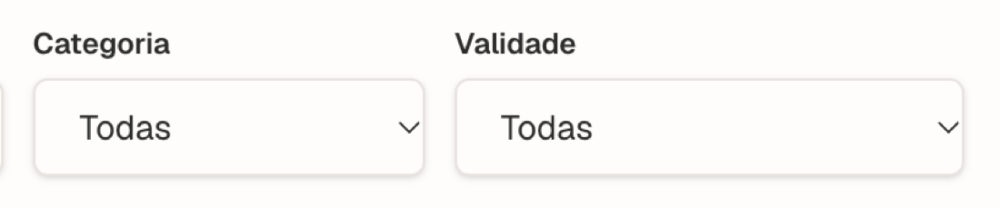 | 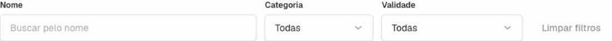 |

Computador:

| Tela | Antes | Depois |
| --- | --- | --- |
| Doadores | 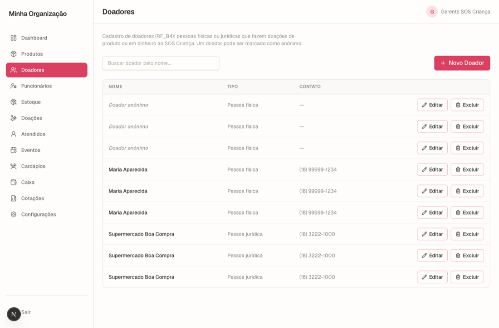 | 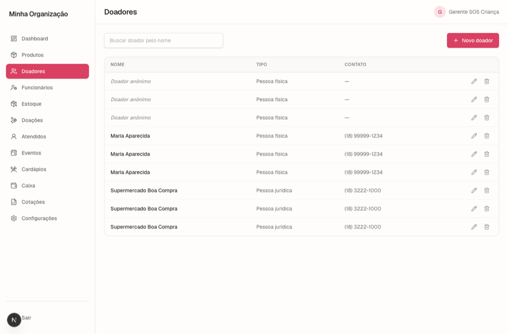 |
| Estoque | 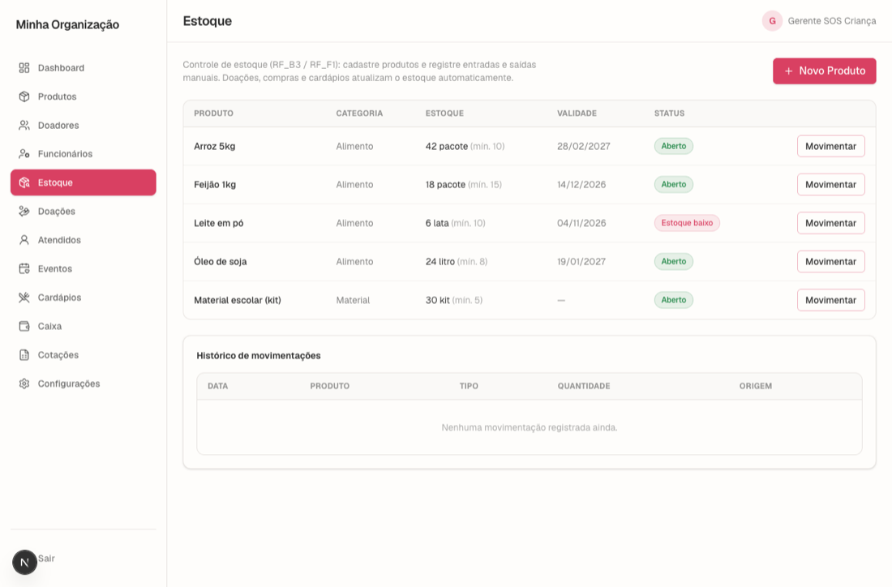 | 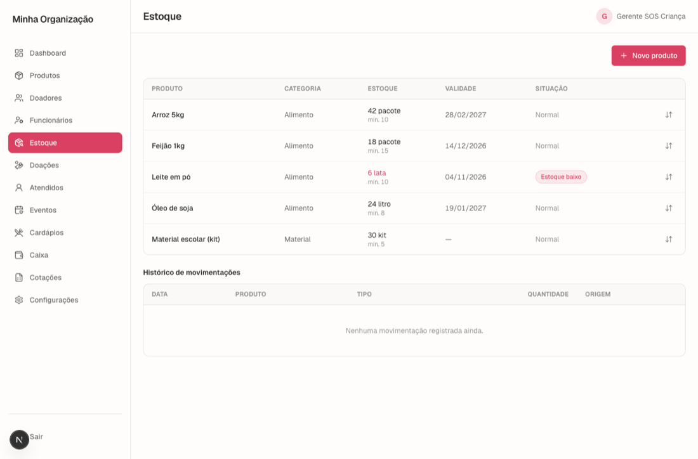 |
| Doações | 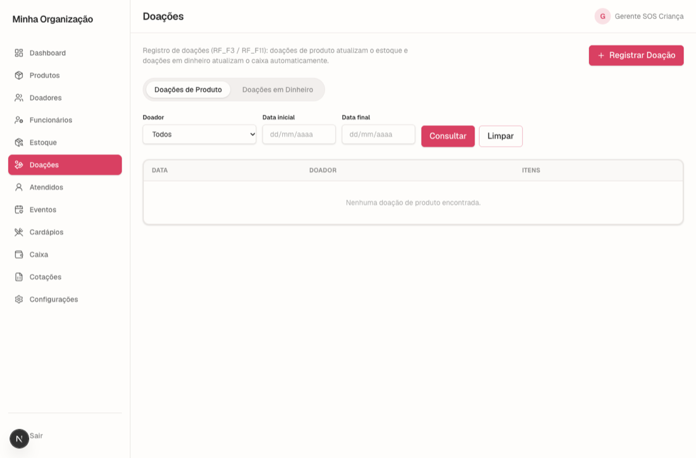 | 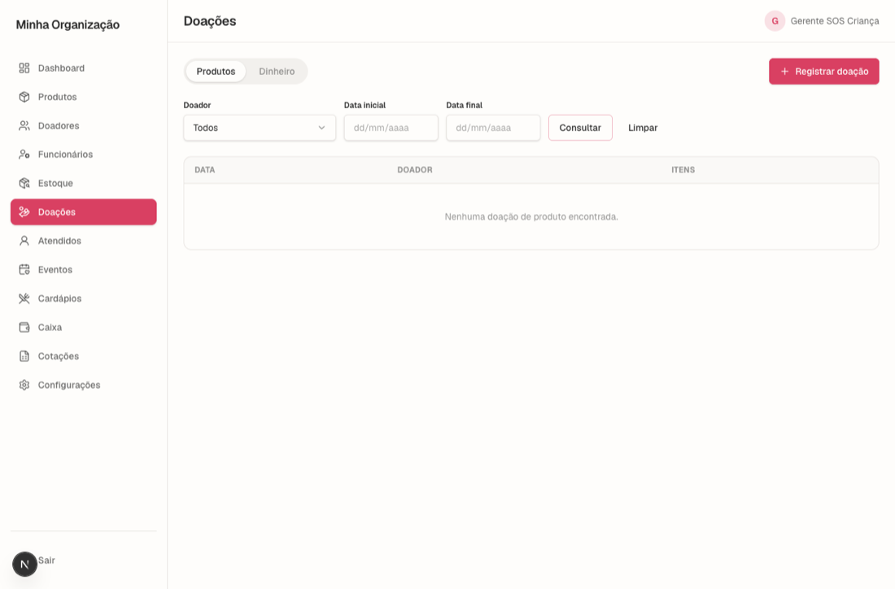 |
| Atendidos | 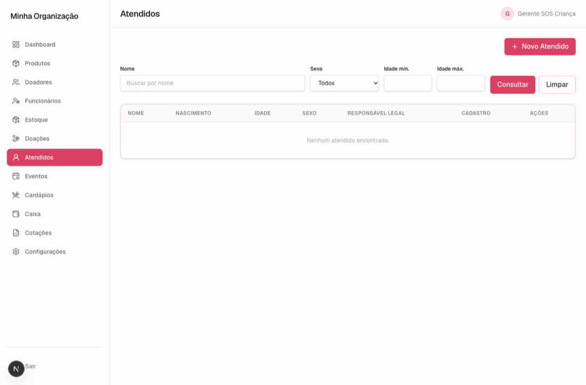 | 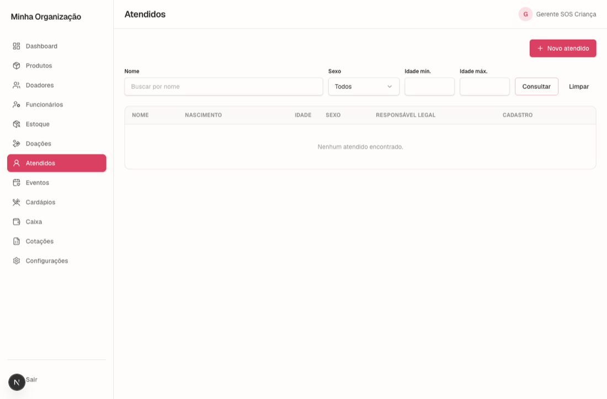 |
| Cotações | 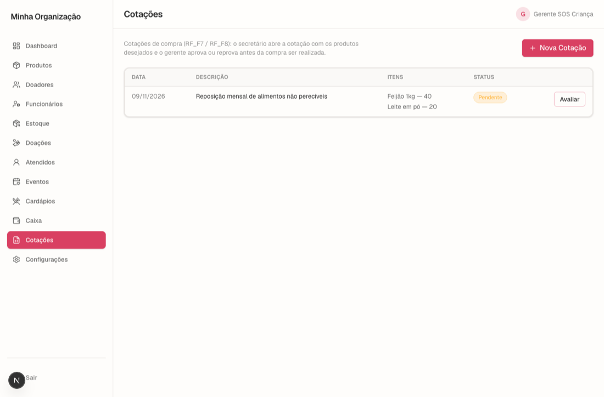 | 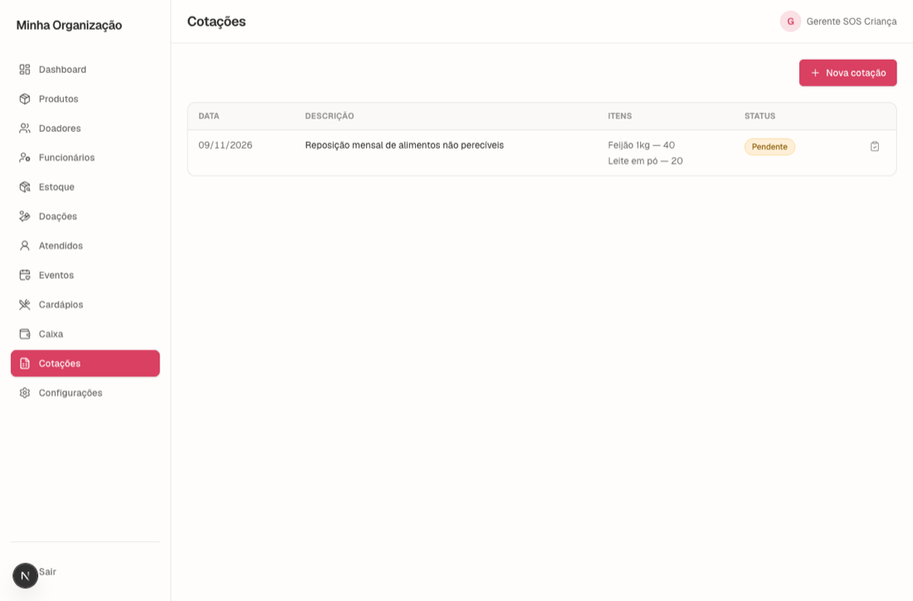 |

Celular:

| Tela | Antes | Depois |
| --- | --- | --- |
| Doadores | 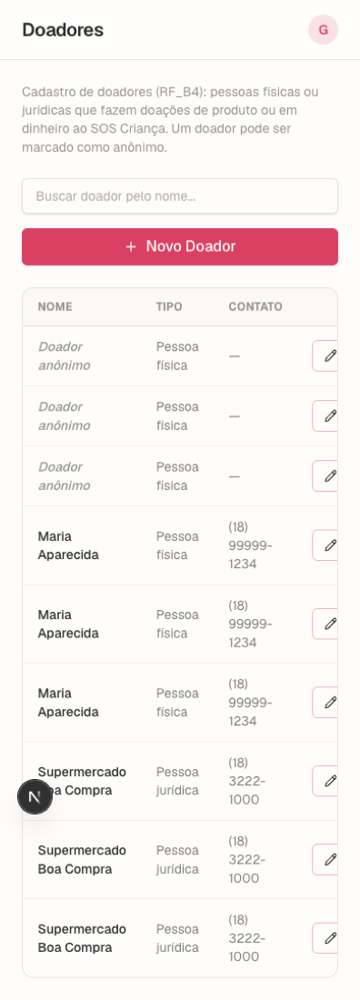 | 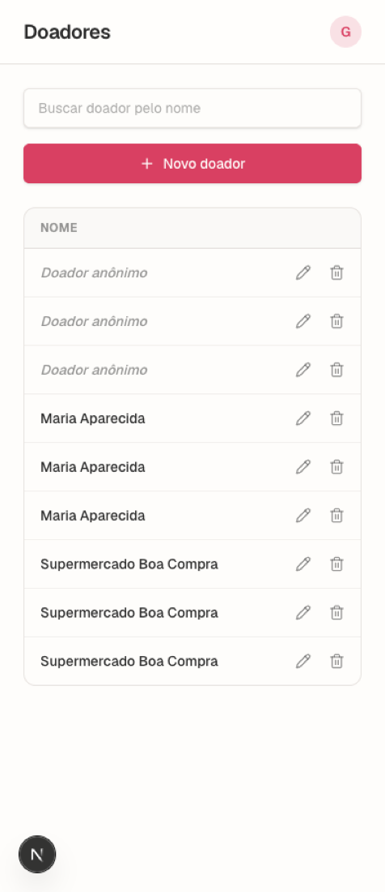 |
| Caixa | 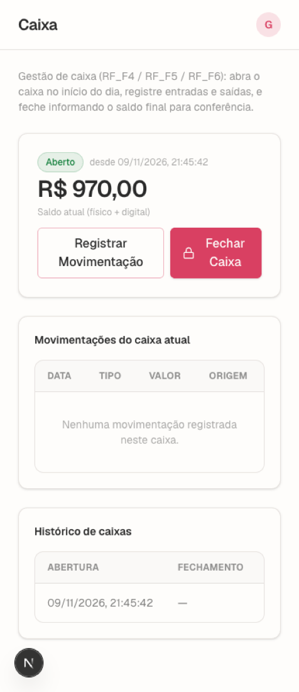 | 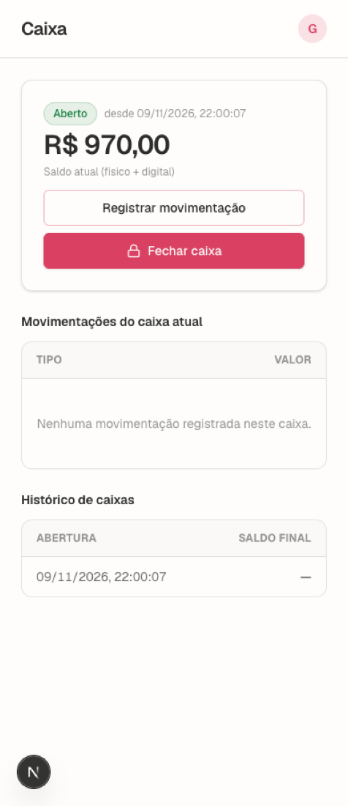 |
| Atendidos | 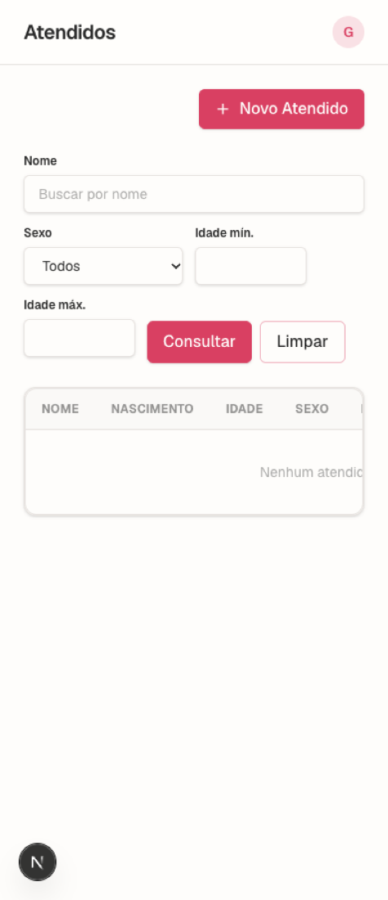 | 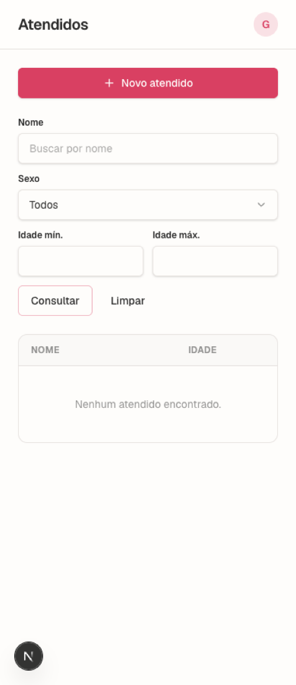 |

---

## 5. Testes feitos

As telas foram abertas num navegador automatizado (Chromium), com os dados reais do banco local, nas larguras de computador (1366px) e celular (390px).

| Teste | Antes | Depois |
| --- | --- | --- |
| Scan do Visant Killer nas 12 telas (padrões de IA, cores, poluição visual) | 12 problemas | 0 |
| Scan do Visant Killer nos componentes compartilhados | 4 problemas | 0 |
| Texto cortado e estouro horizontal (12 telas × 2 larguras) | 0 | 0 |
| Espaçamento fora do padrão | 3 | 1 falso positivo (ver observação 1) |
| Seta do select com folga da borda | colada | 14px nas 4 telas com select |
| Campos e botões com a mesma altura | 38 a 42px misturados | 40px |
| Servidor fora do ar (5 telas que usam a API) | lista vazia ou tela quebrada | mensagem de erro + "Tentar de novo" |
| Modais com Cancelar e Esc (7 telas) | a maioria sem Cancelar; Esc não fechava | os dois funcionam |
| Foco visível pelo teclado (12 telas × 2 larguras) | faltava em botões | visível em todos |
| Título das páginas | 18px | 20px |
| Landing e login (usam o mesmo botão) | — | sem estouro e sem erros |
| Testes automáticos (`npm test`) | 113 de 113 | 113 de 113 |
| Tipos (`tsc`) e build de produção | sem erros | sem erros |
| Lint (`eslint`) | 14 avisos antigos | os mesmos 14, nenhum novo |

### Observações

1. **Falso positivo do scanner de espaçamento.** Na tabela de Funcionários o scanner ainda aponta "proximidade invertida". Ele lê o espaço interno das células como se fossem grupos, mas as linhas são separadas por borda, que agrupa mais forte que a distância. Na tabela de Estoque o mesmo aviso sumiu quando as células passaram a ter duas linhas, o que confirma a leitura.
2. **Hierarquia dentro do conteúdo.** O scanner de hierarquia procura um título dentro da área de conteúdo. O título de cada tela fica no cabeçalho (20px) e cumpre esse papel, então o aviso não se aplica.
3. **Nenhum dado foi alterado nos testes.** Os testes só abriram formulários e janelas. Envios foram feitos apenas com formulário vazio (recusado pelo servidor) ou com o envio cancelado no meio.

### Não testado

- **Celular físico:** os testes de celular usaram um navegador na largura de 390px.
- **Rede lenta:** o estado de carregamento foi visto só no código e no teste de servidor fora do ar.
- **Leitor de tela:** os rótulos (`aria-label`, `role="dialog"`, `role="tab"`) foram adicionados, mas não foram testados com um leitor de tela de verdade.
- **Registros com textos muito longos:** nomes de 120 caracteres, por exemplo.

---

## 6. O que ficou de fora

- **Exclusão com `confirm()` do navegador** em Doadores. Funciona, mas é diferente da janela de confirmação de Produtos e Atendidos. Pode virar um Modal quando o dono da tela quiser.
- **Campo de arquivo em Configurações:** "Choose File / No file chosen" vem do navegador em inglês. Trocar exige um botão próprio de upload.
- **Nome do usuário no cabeçalho** ("Gerente SOS Criança") está fixo no código, e não vem do login.

---

## 7. Como revisar

Cada dono de tela pode conferir a sua parte:

1. `git checkout feat/padronizacao-visual`
2. Dentro de `atlas-app`: `npm install`, `npm run db:up`, `npm run dev`
3. Abrir a tela em http://localhost:3000 no computador e no modo celular do navegador (F12, ícone de celular)

Se algo da sua tela não estiver como você quer, comente no PR com o nome da tela.
